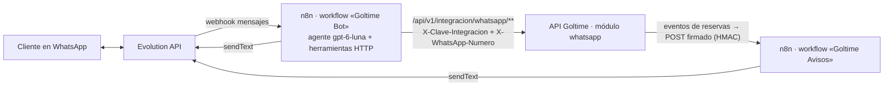

# ADR 0018: Bot de WhatsApp con n8n y Evolution API

- Estado: aprobada (24/oct/2026), en implementación en la rama `feat/bot-whatsapp`
- Contexto: se quiere un bot de WhatsApp que consulte precios, disponibilidad, torneos y marcadores, y que cree, vea, cancele y reprograme reservas. Ya existe un stack propio de n8n + Evolution API (WhatsApp no oficial, Baileys) con otros bots. Las reglas de negocio (precio en el backend, anti-solapamiento, aprobación del admin, trazabilidad) no pueden saltarse por entrar desde otro canal.

## Arquitectura

El LLM solo conversa y elige herramientas. Precios, disponibilidad, políticas, posiciones y resúmenes salen del backend; el bot no calcula nada.

## Decisiones

1. **Origen `WHATSAPP`, no otro tipo de reserva.** `reservas.origen` ya distingue `WEB`, `ADMIN`, `TORNEO`, `RECURRENTE`; se suma `WHATSAPP`. Toda reserva por WhatsApp nace `PENDIENTE`, retiene el horario y la aprueba el admin como cualquier otra (regla 2). Pasa por el mismo `EXCLUDE` (regla 1) y guarda la instantánea de precio (regla 3).

2. **Identidad híbrida por número.**
   - El teléfono pasa a ser **obligatorio y normalizado a E.164** (`+573001234567`) en el registro y en el perfil. Un objeto de valor `NumeroTelefono` acepta `3001234567`, `+57 300 123 4567`, `573001234567`, etc., y siempre guarda lo mismo. En la web: selector de país (+57 por defecto) y número.
   - Nueva columna `usuarios.telefono_verificado`. Índice único parcial sobre `telefono` **solo de números verificados**: cualquiera puede escribir un número al registrarse, pero solo una cuenta puede quedarse con él.
   - **Vinculación automática al primer mensaje.** Si el número que escribe coincide con una cuenta no verificada, el bot dice «Encontramos una cuenta a nombre de J*** P***» y el backend envía un código de 6 dígitos **al correo de esa cuenta** (SMTP ya existe). Al responder el código al bot, el número queda verificado. Así se prueba que quien tiene el WhatsApp también tiene la cuenta, sin pasos extra en el registro. Cambiar el teléfono en el perfil lo vuelve no verificado.
   - Número verificado → actúa como ese **cliente**: suma premios, respeta `max_reservas_activas_cliente`, aparece en «Mis reservas». Un cliente desactivado no puede usar el bot (regla 7).
   - La verificación vive en el módulo `autenticacion` (`ServicioVerificacionTelefono`), igual que la del correo: `usuarios` no puede depender de `notificaciones` (lo prohíbe `ArquitecturaTest` por ciclo).
   - Los teléfonos de clientes de mostrador también se normalizan, para reconocerlos cuando escriban por WhatsApp.
   - Número sin cuenta → **cliente sin cuenta** (`clientes_mostrador`, nombre + teléfono). Límite propio de solicitudes activas por número (configurable) para evitar que alguien retenga horarios en masa.

3. **El número nunca lo elige el LLM.** n8n toma el número del webhook de Evolution (resolviendo los JID `@lid` con `senderPn`/`remoteJidAlt`) y lo pone fijo en la cabecera `X-WhatsApp-Numero` de cada herramienta; el LLM solo rellena parámetros de negocio (`$fromAI`). Las reservas se identifican por `codigo` y el backend comprueba que pertenezcan a ese número (anti-IDOR). Un «resérvale a mi amigo el 300…» no puede cambiar de dueño.

4. **Módulo `whatsapp` con endpoints hechos para conversar** (`/api/v1/integracion/whatsapp/**`). Se prefieren a los públicos porque devuelven respuestas compactas (menos tokens): por ejemplo, la disponibilidad pública trae cada bloque de cada cancha con su estado; la del bot solo trae franjas libres con precio.
   | Endpoint | Para qué |
   |---|---|
   | `GET /contexto` | Quién escribe (cliente, sin cuenta, vinculación pendiente), sedes, contacto, políticas vigentes, si el bot está activo |
   | `GET /canchas` | Sedes y canchas reservables (modalidad, sede) |
   | `GET /disponibilidad` | Franjas libres de un día con precio (sede/modalidad opcionales) |
   | `GET /cotizacion` | Precio exacto de una cancha y franja |
   | `POST /reservas` | Solicitud `PENDIENTE` con `Idempotency-Key` = id del mensaje de WhatsApp |
   | `GET /reservas` | Mis reservas próximas |
   | `POST /reservas/{codigo}/cancelar` | Con motivo |
   | `POST /reservas/{codigo}/reprogramar/previsualizar` y `/reprogramar` | Con motivo |
   | `GET /torneos` · `/torneos/{id}/tabla` · `/torneos/{id}/partidos` | Torneos activos, posiciones, próximos y jugados con marcador |
   | `GET /partidos/{id}/resumen` | Marcador, goles del partido (jugador y minuto) y expulsiones; un texto corto |
   | `POST /vinculacion/codigo` · `/vinculacion/confirmar` | Verificación del número |

   No se exponen goleadores del torneo, tarjetas acumuladas, jugadores ni datos de contacto. Los endpoints llaman a los servicios de aplicación de `reservas`, `sedes` y `torneos`, nunca a sus repositorios.

5. **Políticas compartidas con la web.** Cancelar y reprogramar ya usan `configuracion.politica()` (`horas_minimas_cancelacion`, `max_reprogramaciones`, antelaciones). El bot llama a los mismos servicios, así que si el admin cambia esos valores aplican igual en la web y en WhatsApp sin tocar nada más. Si ya es tarde, el backend responde el `CodigoError` de siempre y el bot lo traduce a «ya no se puede por aquí, gestiónalo en la web o con el admin».

6. **Trazabilidad (regla 4).** El historial y la auditoría registran el canal `WHATSAPP`, el número y, si existe, el usuario. Para clientes sin cuenta el actor es `CLIENTE` sin `usuario_id` y el número en los datos.

7. **Seguridad de la integración.** Cadena de filtros propia para `/api/v1/integracion/**`: cabecera `X-Clave-Integracion` comparada en tiempo constante contra `WHATSAPP_CLAVE_INTEGRACION`; sin esa variable la integración queda apagada. Rol `INTEGRACION`, que no sirve en ninguna otra ruta. Las rutas nuevas entran en `RutasProtegidasIT`. Límite de mensajes por número en el backend.

8. **Avisos salientes por eventos.** `reservas` publica eventos (aprobada, rechazada, expirada, cancelada o reprogramada por el admin, recordatorio). El módulo `whatsapp` los escucha después del commit y, si el destinatario tiene número verificado o la reserva vino de WhatsApp, envía `{numero, texto}` al webhook de n8n firmado con HMAC (`WHATSAPP_SECRETO_AVISOS`). Las plantillas de texto viven en el backend; n8n solo reenvía a Evolution, sin LLM (gratis y predecible). Un fallo de envío se registra y no rompe la operación. Opcional: avisar al admin por WhatsApp de cada solicitud nueva.

9. **Agente en n8n.**
   - Modelo `gpt-6-luna` (USD 0,10 entrada / 0,01 entrada en caché / 0,50 salida por millón de tokens, el más barato de OpenAI con herramientas), por la Responses API con razonamiento `low`. Por Chat Completions solo admite herramientas con razonamiento `none`.
   - Memoria de ventana corta por número (10 mensajes), máximo 6 pasos de herramientas por mensaje, respuestas breves. El prompt de sistema fijo aprovecha la caché.
   - Solo habla de Goltime: cualquier otro tema recibe una respuesta fija. Nunca inventa precios, horarios ni resultados; siempre consulta una herramienta. Antes de reservar, cancelar o reprogramar resume (cancha, fecha, hora, precio) y espera un «sí» explícito.
   - Cada mensaje llega con la fecha y hora de Bogotá, para resolver «mañana a las 8».
   - Solo texto; a audios e imágenes responde que por ahora solo lee texto.
   - Credencial de OpenAI propia de Goltime para medir su costo aparte de los otros bots.

10. **Panel de administración y web.**
    - Reservas y agenda: insignia «WhatsApp», filtro por origen y, en clientes sin cuenta, nombre y teléfono con enlace `wa.me`.
    - Configuración, sección «Bot de WhatsApp»: activo/inactivo (interruptor de emergencia), aceptar reservas de números sin cuenta, máximo de solicitudes activas por número sin cuenta, número del negocio, avisar al admin.
    - Estadísticas: reservas e ingresos por origen.
    - Clientes: columna «WhatsApp verificado».
    - Público: botón «Reserva por WhatsApp» si el número del negocio está configurado.
    - Perfil del cliente: estado del WhatsApp (verificado o pendiente).

11. **Infraestructura pensada para desplegar.**
    - **Cambio (24/oct/2026):** el stack viejo de n8n + Evolution (bots de otros negocios que ya no se usan) se respaldó en `~/Documents/Respaldos/n8n-project-2026-10-24` y se borró. n8n 2.40.5, Evolution v2.3.7 y su PostgreSQL ahora viven **en este repo**, en `docker-compose.whatsapp.yml`, que se suma al compose principal: `docker compose -f docker-compose.yml -f docker-compose.whatsapp.yml up -d`. Sin ese archivo, `docker compose up` sigue funcionando sin bot.
    - Todos comparten la red del proyecto: n8n llama a `http://api:8080` y a `http://evolution-api:8080`; la API avisa a `http://n8n:5678`. Evolution queda en el puerto 8082 del host (el 8080 es de la API).
    - Todo por variables de entorno (`WHATSAPP_CLAVE_INTEGRACION`, `WHATSAPP_URL_AVISOS`, `WHATSAPP_SECRETO_AVISOS`, `N8N_*`, `EVOLUTION_*`). En un VPS solo cambian URLs y secretos.
    - `scripts/whatsapp/conectar.sh <número>` crea la instancia `goltime` con su webhook hacia n8n y deja un QR fresco (o un código para vincular por número).
    - Los workflows se exportan sin credenciales a `integraciones/n8n/` con un script para generarlos e importarlos.
    - `docs/despliegue-whatsapp.md`: guía y lista de chequeo.
    - Riesgo conocido: Evolution/Baileys no es oficial y el número puede ser bloqueado. Como todo lo de WhatsApp vive en n8n, pasar a la API oficial de WhatsApp Cloud no toca el backend.

## Consecuencias

- Migración `V13`: `telefono_verificado`, normalización de teléfonos existentes, índice único parcial y `verificaciones_telefono`. Migración `V14`: origen `WHATSAPP`, idempotencia para clientes sin cuenta y las claves `whatsapp_*` de configuración. El canal queda en el historial (`datos_nuevos.canal`).
- `reservas` aprendió a solicitar a nombre de un cliente sin cuenta (`Titular`), y publica `AvisoReservaEvento` cada vez que avisa al titular; `whatsapp` lo escucha. La lista de espera solo se cumple para clientes registrados.
- Las reservas de clientes sin cuenta por WhatsApp no suman premios ni lista de espera.
- El bot depende de que Evolution y n8n estén arriba; si caen, la web sigue igual y los avisos se pierden (se registran en el log).
