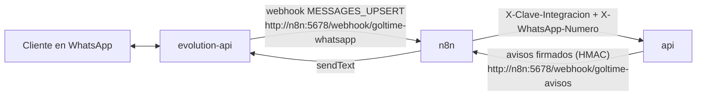

# Bot de WhatsApp: puesta en marcha y despliegue

Cómo levantar el bot de WhatsApp de Goltime (ADR 0018) en local y qué cambia el día que se despliegue en un servidor.

## Piezas

| Servicio | Imagen | Puerto local | Para qué |
|---|---|---|---|
| `n8n` | `docker.n8n.io/n8nio/n8n:2.40.5` | 5678 | Workflows del bot: recibe los mensajes, conversa con el modelo y llama a la API |
| `evolution-api` | `evoapicloud/evolution-api:v2.3.7` | 8082 | Conexión con WhatsApp (QR, enviar y recibir mensajes) |
| `evolution-db` | `postgres:16-alpine` | — | Datos de Evolution (sesión del número, contactos) |
| `api` | la de Goltime | 8080 | Expone `/api/v1/integracion/whatsapp/**` para n8n y le avisa los cambios de reservas |

Las versiones están fijas a propósito: actualizar es una decisión, no algo que pase solo al reiniciar.



## En local

1. Variables: copia de `.env.example` el bloque «Bot de WhatsApp» a tu `.env` y genera cada secreto con `openssl rand -hex 32`. No cambies `N8N_CLAVE_CIFRADO` después de crear credenciales en n8n.
2. Levantar todo:

   ```bash
   docker compose -f docker-compose.yml -f docker-compose.whatsapp.yml up -d
   ```

3. Conectar el número del bot (crea la instancia `goltime` con su webhook y deja `qr-whatsapp.png`):

   ```bash
   scripts/whatsapp/conectar.sh 573239085762
   ```

   En el celular: WhatsApp › Dispositivos vinculados › Vincular un dispositivo. El QR vence en unos 40 segundos; si no alcanzas, vuelve a correr el script o usa el código que imprime con «Vincular con el número de teléfono». También puedes ver el QR en vivo en `http://localhost:8082/manager` con `EVOLUTION_CLAVE_API`.
4. Abrir n8n en `http://localhost:5678` y crear la cuenta de dueño (es local, la creas tú).

Para apagar el bot sin tocar Docker: Configuración › `whatsapp_bot_activo = false`. El bot responde que está en pausa y la web sigue igual.

## API del bot

Todas bajo `/api/v1/integracion/whatsapp`, con `X-Clave-Integracion: $WHATSAPP_CLAVE_INTEGRACION`. Las que actúan a nombre de alguien llevan `X-WhatsApp-Numero` con el número del remitente, tomado del mensaje de Evolution (nunca de lo que diga el modelo de lenguaje). Fechas `yyyy-MM-dd` y horas `HH:mm`, en hora de Bogotá. Documentación completa en Swagger (`/swagger-ui.html` en desarrollo).

| Método y ruta | Para qué |
|---|---|
| `GET /contexto` | Quién escribe (`CLIENTE`, `SIN_VERIFICAR`, `SIN_CUENTA`, `DESACTIVADO`), su nombre, fecha y hora, sedes y políticas |
| `POST /vinculacion/codigo` · `POST /vinculacion/confirmar` | Vincular el número con la cuenta (código al correo) |
| `GET /canchas` · `GET /disponibilidad?fecha=` · `GET /cotizacion?canchaId=&fecha=&desde=&hasta=` | Catálogo, franjas libres y precio exacto |
| `POST /reservas` (con `Idempotency-Key` = id del mensaje) · `GET /reservas` | Solicitar y ver las propias |
| `POST /reservas/{codigo}/cancelar` · `/reprogramar/previsualizar` · `/reprogramar` | Gestionar las propias, con la política vigente |
| `GET /torneos` · `/torneos/{id}/tabla` · `/torneos/{id}/partidos?jugados=` · `/partidos/proximos` · `/partidos/{id}/resumen` | Torneos activos, posiciones, marcadores y resumen de un partido |

Errores: `ProblemDetail` con `codigo` (`WHATSAPP_SIN_VINCULAR`, `SERVICIO_NO_DISPONIBLE`, `LIMITE_DE_RESERVAS`, `POLITICA_CANCELACION`, `RESERVA_SOLAPADA`…) y un `detail` en español que el bot puede repetir.

Avisos de la API a n8n: `POST $WHATSAPP_URL_AVISOS` con `{numero, mensaje, tipo, reservaId}` y la cabecera `X-Firma-Goltime: sha256=<HMAC-SHA256 del cuerpo con WHATSAPP_SECRETO_AVISOS>`. n8n debe descartar lo que no tenga la firma correcta.

## Para desplegar en un servidor

Lista de chequeo; nada de esto exige cambiar código:

- [ ] Secretos nuevos para el servidor (no reutilizar los de local) en el `.env` del servidor.
- [ ] `N8N_URL_PUBLICA` y `EVOLUTION_URL_PUBLICA` con el dominio real; `N8N_PROTOCOLO=https` y `N8N_COOKIE_SEGURA=true`.
- [ ] n8n y el manager de Evolution detrás del proxy con HTTPS, y si se puede, solo accesibles por VPN o con lista de IPs: ninguno de los dos necesita estar abierto a internet, porque Evolution habla con WhatsApp hacia afuera y con n8n por la red interna.
- [ ] No publicar los puertos 5678 y 8082 en el host del servidor (quitar `ports:` o ligarlos a `127.0.0.1`).
- [ ] Respaldos de los volúmenes `datos_n8n`, `datos_evolution_db` y `datos_evolution_instancias` junto con los de la base de Goltime.
- [ ] Volver a conectar el número con `scripts/whatsapp/conectar.sh` (la sesión de WhatsApp vive en el volumen de Evolution).
- [ ] Credencial de OpenAI propia de Goltime en n8n, con límite de gasto mensual en la cuenta de OpenAI.

## Riesgos conocidos

- Evolution usa Baileys (WhatsApp Web no oficial): WhatsApp puede bloquear el número si detecta abuso. Mitigación: un número dedicado al bot, sin envíos masivos y respuestas solo a quien escribe. Si un día se pasa a la API oficial de WhatsApp Cloud, solo cambian los workflows de n8n; la API de Goltime no se entera.
- Si n8n o Evolution caen, la web sigue igual y los avisos por WhatsApp de ese rato se pierden (quedan en el log de la API).
