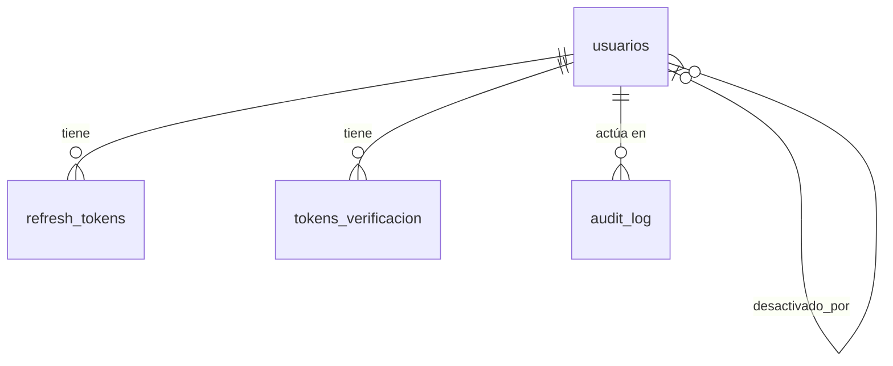

# Modelo de datos

Fuente de verdad: las migraciones Flyway en `backend/src/main/resources/db/migration/`. Este documento explica cada tabla y se amplía con cada fase (servirá para el modelo relacional del informe).

Convenciones: ids `BIGINT` identity, fechas `timestamptz` (UTC), enums como `VARCHAR` + `CHECK`, nombres en español. Las tablas de negocio llevan `creado_en`, `actualizado_en`, `creado_por`, `actualizado_por`.

## V1: base, usuarios, auditoría y configuración

| Tabla | Propósito | Notas |
|---|---|---|
| `usuarios` | Cuentas de `ADMIN` y `CLIENTE` | Correo único sin distinguir mayúsculas (`uq_usuarios_correo` sobre `lower(correo)`). `version_token` invalida tokens al desactivar o cambiar clave. `puede_inscribir_equipos` lo habilita el admin por cliente. `version` para bloqueo optimista |
| `clientes_mostrador` | Personas sin cuenta para las que el admin crea reservas | Nombre y teléfono |
| `refresh_tokens` | Refresh tokens opacos | Solo se guarda el hash. `familia_id` agrupa la cadena de rotación; `reemplazado_por` enlaza al token siguiente |
| `tokens_verificacion` | Tokens de un solo uso | Tipos `VERIFICAR_CORREO` y `RESTABLECER_CLAVE`; solo hash; expiran a los 30 min |
| `configuracion` | Parámetros del negocio (clave/valor tipado) | Se siembran los valores por defecto aprobados: 4 h de cancelación, 2 reprogramaciones, expiración de pendientes 12 h o 2 h antes del inicio, etc. |
| `audit_log` | Bitácora de acciones administrativas | `cambios` en JSONB; índices por entidad y por fecha |

## V2: refresh tokens persistentes

`refresh_tokens.recordar` (boolean): conserva si la sesión es persistente ("recordarme", 7 días) o de sesión (12 horas) al rotar el token.

Extensión requerida: `btree_gist` (para la restricción de exclusión de reservas, desde la Fase 2/3).

## Relaciones

## Pendiente por fase

- Fase 2: `sedes`, `sede_horarios`, `canchas`, `cancha_composicion`, `tarifas`, `festivos`, fotos.
- Fase 3: `reservas` (con `aprobada_por`, `fecha_aprobacion`, `motivo_rechazo`, `expira_en`), `ocupaciones_cancha` con `EXCLUDE`, `reserva_historial`, `pagos`, `notificaciones`.
- Fase 4: `bloqueos`, `bloqueo_canchas`.
- Fases 5 a 8: torneos, promociones, premios, series de reservas, lista de espera. Ver [propuesta-inicial.md](propuesta-inicial.md).
