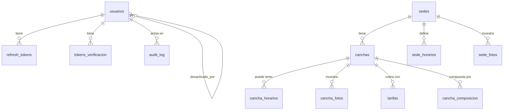

# Modelo de datos

Fuente de verdad: las migraciones Flyway en `backend/src/main/resources/db/migration/`. Este documento explica cada tabla y se amplía con cada fase (servirá para el modelo relacional del informe).

Convenciones: ids `BIGINT` identity, fechas `timestamptz` (UTC), enums como `VARCHAR` + `CHECK`, nombres en español. Las tablas de negocio llevan `creado_en`, `actualizado_en`, `creado_por`, `actualizado_por`.

## V1: base, usuarios, auditoría y configuración

| Tabla | Propósito | Notas |
|---|---|---|
| `usuarios` | Cuentas de `ADMIN` y `CLIENTE` | Correo único sin distinguir mayúsculas (`uq_usuarios_correo` sobre `lower(correo)`). `version_token` invalida tokens al desactivar o cambiar clave. `puede_inscribir_equipos` lo habilita el admin por cliente. `version` para bloqueo optimista |
| `clientes_mostrador` | Personas sin cuenta para las que el admin crea reservas | Nombre y teléfono |
| `refresh_tokens` | Refresh tokens opacos | Solo se guarda el hash. `familia_id` agrupa la cadena de rotación; `reemplazado_por` enlaza al token siguiente |
| `tokens_verificacion` | Tokens de un solo uso | Tipos `VERIFICAR_CORREO` y `RESTABLECER_CLAVE`; solo hash; expiran a los 30 min |
| `configuracion` | Parámetros del negocio (clave/valor tipado) | Se siembran los valores por defecto aprobados: 4 h de cancelación, 2 reprogramaciones, expiración de pendientes 12 h o 2 h antes del inicio, etc. |
| `audit_log` | Bitácora de acciones administrativas | `cambios` en JSONB; índices por entidad y por fecha |

## V2: refresh tokens persistentes

`refresh_tokens.recordar` (boolean): conserva si la sesión es persistente ("recordarme", 7 días) o de sesión (12 horas) al rotar el token.

## V3: sedes, canchas, horarios, tarifas y festivos

Las horas del día se guardan como **minutos desde la medianoche** (`minuto_apertura` 0..1439, `minuto_cierre` 1..1440) para poder expresar un cierre a las 24:00, que un `TIME` no permite sin ambigüedad. `dia_semana` es ISO-8601 (1 = lunes ... 7 = domingo).

| Tabla | Propósito | Notas |
|---|---|---|
| `sedes` | Sedes del negocio | Nombre único sin distinguir mayúsculas. `servicios` es JSONB (lista de textos). Desactivar = `activa = false` (borrado lógico) |
| `sede_horarios` | Horario de operación por día | `UNIQUE(sede_id, dia_semana)`; `CHECK`: cerrado o cierre > apertura |
| `sede_fotos`, `cancha_fotos` | Fotos | Solo se guarda el nombre aleatorio del archivo; el archivo vive en el volumen de uploads |
| `canchas` | Canchas de una sede | `modalidad` ("F5") deriva de `jugadores_por_equipo`. `UNIQUE(sede_id, lower(nombre))`. Estados `ACTIVA`, `MANTENIMIENTO`, `INACTIVA`. Duración mínima y máxima múltiplos del bloque |
| `cancha_horarios` | Horario propio de una cancha | Reemplaza al de la sede solo en los días definidos |
| `cancha_composicion` | Canchas que dependen de otras | `(cancha_compuesta_id, cancha_componente_id)`. Un solo nivel de dependencia; las componentes deben ser de la misma sede (validado en la aplicación) |
| `tarifas` | Franjas de precio por hora de una cancha | `dias_semana SMALLINT[]`, rango en minutos, `aplica_festivo`, vigencia opcional. Una franja normal exige días; una de festivo rige solo en festivos |
| `festivos` | Festivos de Colombia | Fecha única. V4 carga 2026 y 2027 (Ley Emiliani); el admin puede agregar o quitar |

`configuracion` suma `modalidades_permitidas` (`5,6,7,8,9,11`).

### Reglas de precio (`CalculadoraPrecio`)

El intervalo se parte en cada cambio de franja y a medianoche; cada tramo cuesta `minutos / 60 × precio_hora` y el total se redondea al peso. Por minuto rige, en este orden: franja de festivo (si la fecha es festivo) → franja normal del día → precio base de la cancha. Dos franjas del mismo tipo no pueden solaparse (mismos días, horas y vigencia).

## V5: reservas, ocupaciones, historial y notificaciones

| Tabla | Propósito | Notas |
|---|---|---|
| `reservas` | Reservas de canchas | `codigo` legible (`GT-2026-000123`, secuencia `reservas_codigo_seq`). Estados `PENDIENTE`, `CONFIRMADA`, `RECHAZADA`, `EXPIRADA`, `CANCELADA`, `COMPLETADA`, `NO_ASISTIO`. Guarda el **precio como instantánea** (`precio_base`, `descuento`, `precio_final`). `CHECK`: exactamente uno entre `cliente_id` y `cliente_mostrador_id`. Campos de auditoría de la cancelación (`cancelada_por`, `rol_cancelador`, `motivo_cancelacion`, `cancelacion_tardia`), de la aprobación (`aprobada_por`, `motivo_rechazo`, `expira_en`), `veces_reprogramada`, `clave_idempotencia` (único por cliente) y `version` para bloqueo optimista |
| `ocupaciones_cancha` | Qué cancha está ocupada y cuándo | `rango TSTZRANGE` y **`EXCLUDE USING gist (cancha_id WITH =, rango WITH &&)`**: la base de datos impide que dos ocupaciones se solapen en la misma cancha, aun con peticiones concurrentes. Una reserva de una cancha compuesta ocupa la propia y todas sus componentes. `tipo` = `RESERVA` o `BLOQUEO` (los bloqueos llegan en la Fase 4) |
| `reserva_historial` | Quién hizo qué en cada reserva | `accion`, `actor_id`, `actor_rol` (`ADMIN`, `CLIENTE`, `SISTEMA`), `motivo`, `datos_anteriores` y `datos_nuevos` en JSONB |
| `notificaciones` | Notificaciones in-app | Por usuario, con `leida` y enlace opcional a una entidad |

V5 también sube `antelacion_minima_horas` de 1 a 3: con aprobación del admin la solicitud necesita tiempo para ser respondida antes de expirar.

## V6: bloqueos y pagos

| Tabla | Propósito | Notas |
|---|---|---|
| `bloqueos` | Bloqueos de horario de una sede | `tipo` `PUNTUAL` (intervalo `inicio`-`fin`, o días completos con `todo_el_dia`) o `RECURRENTE` (`dias_semana`, `minuto_inicio`/`minuto_fin`, entre `fecha_desde` y `fecha_hasta`, máximo un año). `motivo_tipo` (mantenimiento, evento privado, torneo, clima, otro) y `motivo_detalle`. Borrado lógico con `activo` |
| `bloqueo_canchas` | Canchas elegidas para el bloqueo | Sin filas = toda la sede |
| `pagos` | Pagos, abonos y reembolsos registrados por el admin | `tipo` `PAGO`, `ABONO` o `REEMBOLSO`; `metodo` (efectivo, transferencia, Nequi, Daviplata, tarjeta en sitio); `registrado_por` |

Un bloqueo se materializa como filas de `ocupaciones_cancha` con `tipo = 'BLOQUEO'` (una por cancha afectada e intervalo futuro), así que la restricción de exclusión impide reservar encima de él y también que dos bloqueos se pisen. V6 agrega la llave foránea `ocupaciones_cancha.bloqueo_id -> bloqueos`.

Estados de pago de una reserva (`reservas.estado_pago`): `PENDIENTE` -> `ABONADO` -> `PAGADO`; al cancelarse, rechazarse o expirar con dinero pagado pasa a `REEMBOLSO_PENDIENTE`, y los reembolsos la llevan a `REEMBOLSADO`.

Extensión requerida: `btree_gist` (para la restricción de exclusión de reservas, desde la Fase 2/3).

### V7: torneos (Fase 5)

| Tabla | Para qué sirve | Notas |
|---|---|---|
| `equipos`, `jugadores` | Catálogo reutilizable | Nombre de equipo único sin distinguir mayúsculas; `documento` único si existe |
| `equipo_jugadores` | Plantilla habitual del equipo | Dorsal único entre los activos |
| `torneos` | Configuración del torneo | `formato`, `estado`, puntos 3/1/0, `criterios_desempate` (JSONB en orden), `marcador_wo_goles`, podio (`campeon_id`, `subcampeon_id`, `tercero_id`) |
| `torneo_canchas` | Canchas elegidas para el torneo | Vacío = cualquiera de la sede |
| `inscripciones_torneo` | Un equipo en un torneo | Única por (torneo, equipo); `semilla`; estado `SOLICITADA/APROBADA/RECHAZADA/RETIRADA` |
| `plantillas_torneo` | Jugadores del equipo en ese torneo | Un jugador solo en un equipo por torneo; dorsal único por inscripción |
| `fases`, `grupos`, `grupo_equipos` | Estructura del fixture | Tipos `GRUPOS`, `LIGA`, `ELIMINATORIA` |
| `partidos` | Cada partido o descanso | `siguiente_partido_id` + `lado_en_siguiente` (y los del perdedor) para el cuadro; `ref_local/ref_visitante` para clasificados por definir; `reserva_id` de la reserva interna |
| `eventos_partido` | Goles, asistencias, tarjetas | `evento_relacionado_id` liga la asistencia al gol |

Además, `reservas.ck_reservas_cliente` permite reservas sin cliente solo con `origen = 'TORNEO'`.

### V8: promociones y premios (Fase 7)

| Tabla | Para qué sirve | Notas |
|---|---|---|
| `promociones` | Descuentos con vigencia, días, franja, sede/cancha, cupos | Código único sin distinguir mayúsculas; sin código = automática |
| `usos_promocion` | Un uso por reserva | `reserva_id` único; estado `ACTIVO` o `LIBERADO` (cuenta para los cupos solo si está activo) |
| `reglas_premio` | "Cada N reservas completadas, un beneficio" | Porcentaje o monto fijo, vigencia en días |
| `premios_cliente` | Premios ganados | Copia el beneficio; estados `DISPONIBLE`, `USADO`, `VENCIDO`, `REVOCADO` |

## Relaciones

## Pendiente por fase

- Fase 3: `reservas` (con `aprobada_por`, `fecha_aprobacion`, `motivo_rechazo`, `expira_en`), `ocupaciones_cancha` con `EXCLUDE`, `reserva_historial`, `pagos`, `notificaciones`.
- Fase 4: `bloqueos`, `bloqueo_canchas`, `pagos`.
- Fase 5: ver V7 abajo.
- Fase 6: sin tablas nuevas (lee reservas, pagos y horarios).
- Fase 7: ver V8 abajo.
- Fase 8: series de reservas, lista de espera. Ver [propuesta-inicial.md](propuesta-inicial.md).
