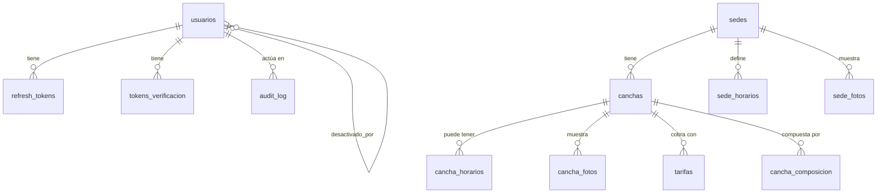

# Modelo de datos

Fuente de verdad: las migraciones Flyway en `backend/src/main/resources/db/migration/`. Este documento explica cada tabla y se amplía con cada fase (servirá para el modelo relacional del informe).

Convenciones: ids `BIGINT` identity, fechas `timestamptz` (UTC), enums como `VARCHAR` + `CHECK`, nombres en español. Las tablas de negocio llevan `creado_en`, `actualizado_en`, `creado_por`, `actualizado_por`.

## V1: base, usuarios, auditoría y configuración

| Tabla | Propósito | Notas |
|---|---|---|
| `usuarios` | Cuentas de `ADMIN` y `CLIENTE` | Correo único sin distinguir mayúsculas (`uq_usuarios_correo` sobre `lower(correo)`). `version_token` invalida tokens al desactivar o cambiar clave. `puede_inscribir_equipos` lo habilita el admin por cliente. `version` para bloqueo optimista |
| `clientes_mostrador` | Personas sin cuenta para las que el admin crea reservas | Nombre y teléfono |
| `refresh_tokens` | Refresh tokens opacos | Solo se guarda el hash. `familia_id` agrupa la cadena de rotación; `reemplazado_por` enlaza al token siguiente |
| `tokens_verificacion` | Tokens de un solo uso | Tipos `VERIFICAR_CORREO` y `RESTABLECER_CLAVE`; solo hash; expiran a los 30 min |
| `configuracion` | Parámetros del negocio (clave/valor tipado) | Se siembran los valores por defecto aprobados: 4 h de cancelación, 2 reprogramaciones, expiración de pendientes 12 h o 2 h antes del inicio, etc. |
| `audit_log` | Bitácora de acciones administrativas | `cambios` en JSONB; índices por entidad y por fecha |

## V2: refresh tokens persistentes

`refresh_tokens.recordar` (boolean): conserva si la sesión es persistente ("recordarme", 7 días) o de sesión (12 horas) al rotar el token.

## V3: sedes, canchas, horarios, tarifas y festivos

Las horas del día se guardan como **minutos desde la medianoche** (`minuto_apertura` 0..1439, `minuto_cierre` 1..1440) para poder expresar un cierre a las 24:00, que un `TIME` no permite sin ambigüedad. `dia_semana` es ISO-8601 (1 = lunes ... 7 = domingo).

| Tabla | Propósito | Notas |
|---|---|---|
| `sedes` | Sedes del negocio | Nombre único sin distinguir mayúsculas. `servicios` es JSONB (lista de textos). Desactivar = `activa = false` (borrado lógico) |
| `sede_horarios` | Horario de operación por día | `UNIQUE(sede_id, dia_semana)`; `CHECK`: cerrado o cierre > apertura |
| `sede_fotos`, `cancha_fotos` | Fotos | Solo se guarda el nombre aleatorio del archivo; el archivo vive en el volumen de uploads |
| `canchas` | Canchas de una sede | `modalidad` ("F5") deriva de `jugadores_por_equipo`. `UNIQUE(sede_id, lower(nombre))`. Estados `ACTIVA`, `MANTENIMIENTO`, `INACTIVA`. Duración mínima y máxima múltiplos del bloque |
| `cancha_horarios` | Horario propio de una cancha | Reemplaza al de la sede solo en los días definidos |
| `cancha_composicion` | Canchas que dependen de otras | `(cancha_compuesta_id, cancha_componente_id)`. Un solo nivel de dependencia; las componentes deben ser de la misma sede (validado en la aplicación) |
| `tarifas` | Franjas de precio por hora de una cancha | `dias_semana SMALLINT[]`, rango en minutos, `aplica_festivo`, vigencia opcional. Una franja normal exige días; una de festivo rige solo en festivos |
| `festivos` | Festivos de Colombia | Fecha única. V4 carga 2026 y 2027 (Ley Emiliani); el admin puede agregar o quitar |

`configuracion` suma `modalidades_permitidas` (`5,6,7,8,9,11`).

### Reglas de precio (`CalculadoraPrecio`)

El intervalo se parte en cada cambio de franja y a medianoche; cada tramo cuesta `minutos / 60 × precio_hora` y el total se redondea al peso. Por minuto rige, en este orden: franja de festivo (si la fecha es festivo) → franja normal del día → precio base de la cancha. Dos franjas del mismo tipo no pueden solaparse (mismos días, horas y vigencia).

Extensión requerida: `btree_gist` (para la restricción de exclusión de reservas, desde la Fase 2/3).

## Relaciones

## Pendiente por fase

- Fase 3: `reservas` (con `aprobada_por`, `fecha_aprobacion`, `motivo_rechazo`, `expira_en`), `ocupaciones_cancha` con `EXCLUDE`, `reserva_historial`, `pagos`, `notificaciones`.
- Fase 4: `bloqueos`, `bloqueo_canchas`.
- Fases 5 a 8: torneos, promociones, premios, series de reservas, lista de espera. Ver [propuesta-inicial.md](propuesta-inicial.md).
