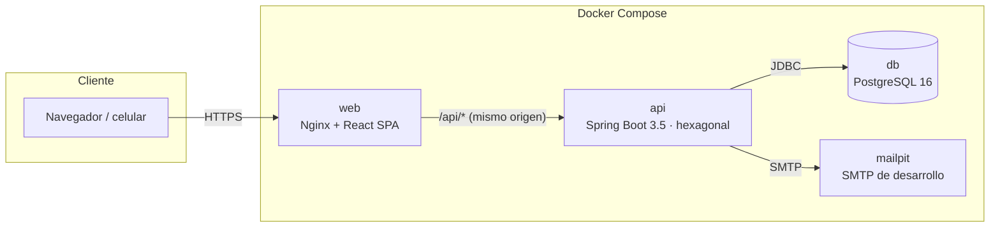
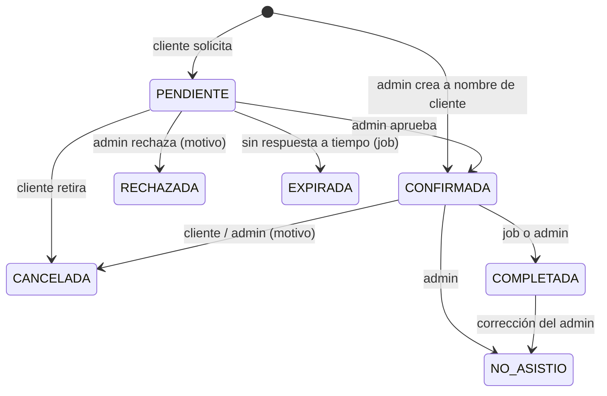

# Goltime — Propuesta inicial (pendiente de aprobación)

Exposición INNOVASOFT IX: 19 de noviembre de 2026. Las fases se ordenan por prioridad, sin fechas por fase: se avanza lo máximo posible en cada sesión.

## 1. Decisiones tomadas (respuestas del equipo)

| # | Tema | Decisión |
|---|---|---|
| 1 | Arquitectura | Hexagonal modular + contenedores separados (web / api / db / mailpit). Sin microservicios. |
| 2 | Equipo | 1 persona; la IA escribe el código, el humano ejecuta, revisa y aprueba. |
| 3 | Gestión de tareas | Se decide luego. Por ahora **todo local**, nada se sube a GitHub. |
| 4 | Negocio | Un solo negocio con varias sedes. |
| 5 | Idioma del código | **Todo en español** (clases, endpoints, tablas, columnas). UI también en español (Colombia). |
| 6 | Confirmación de reservas | **El cliente solicita y el admin aprueba.** Nace `PENDIENTE`; queda `CONFIRMADA` al aprobarla. |
| 7 | Política | Cancelar sin penalidad hasta 4 h antes · máximo 2 reprogramaciones (configurable). |
| 8 | Completar reservas | Job automático a `COMPLETADA`; el admin puede corregir a `NO_ASISTIO`. |
| 9 | Canchas dependientes | Al crear una cancha el admin indica si **depende de otras**; si alguna no está disponible, la compuesta tampoco (y viceversa). |
| 10 | Inscripción a torneos | El cliente puede solicitarla **solo si el admin lo habilitó** para ese cliente. |
| 11 | Extras incluidos | Reservas recurrentes y lista de espera. |
| 12 | Despliegue / correo | Local con Docker + **Mailpit** (gratis). SMTP real y VPS Hostinger más adelante, solo cambiando variables de entorno. |
| 13 | Versiones | Spring Boot 3.5.x, Java 21, PostgreSQL 16, IDs `BIGINT`. |
| 14 | Identidad visual | La propongo yo (sección 5). |

## 2. Arquitectura final

Nginx sirve el build de React y hace proxy de `/api` a la API, así el front y la API comparten origen. Eso permite la cookie `HttpOnly; SameSite=Strict` del refresh token sin configurar CORS en producción.

**Módulos del backend** (paquete base `co.edu.usco.goltime`), cada uno con `dominio/`, `aplicacion/`, `infraestructura/`:

`compartido · autenticacion · usuarios · sedes · reservas · promociones · premios · torneos · notificaciones · auditoria · estadisticas`

Comunicación entre módulos solo por interfaces de aplicación o eventos de dominio (`ReservaCompletadaEvento` → `premios`). Se verifica con ArchUnit.

### Máquina de estados de la reserva (por la aprobación del admin)

Una reserva `PENDIENTE` **sí retiene el horario** (nadie más puede pedirlo) hasta que se resuelva. `RECHAZADA` y `EXPIRADA` liberan el horario y avisan a la lista de espera.

### Canchas dependientes y anti-solapamiento

La restricción `EXCLUDE` de PostgreSQL solo compara filas de **la misma cancha**; no sabe que F8 = F5-A + F5-B. Para mantener la garantía a nivel de BD, propongo una tabla auxiliar:

- `ocupaciones_cancha (reserva_id, cancha_id, rango tstzrange)`: al crear una reserva se insertan filas para la cancha reservada **y para todas las canchas relacionadas** (sus componentes o su cancha compuesta).
- `EXCLUDE USING gist (cancha_id WITH =, rango WITH &&)` vive sobre esa tabla, y se borra/actualiza junto con el estado de la reserva.
- Los bloqueos y los partidos de torneo usan el mismo mecanismo.

Así la disponibilidad compuesta queda protegida igual que la simple, incluso con peticiones concurrentes.

## 3. Modelo de datos final

Parto del modelo del documento maestro (tablas en español, `BIGINT identity`, `created_at/updated_at/created_by/updated_by`, enums como `VARCHAR + CHECK`). **Cambios respecto al documento:**

| Cambio | Motivo |
|---|---|
| `reservas.estado` suma `RECHAZADA` y `EXPIRADA` | Flujo de aprobación del admin. |
| `reservas` suma `aprobada_por`, `fecha_aprobacion`, `motivo_rechazo`, `expira_en` | Trazabilidad de la aprobación. |
| Nueva tabla `ocupaciones_cancha` (con el `EXCLUDE`) | Canchas dependientes (ver sección 2). El `EXCLUDE` deja de estar en `reservas`. |
| `cancha_composicion` pasa de opcional a obligatoria (`cancha_compuesta_id`, `cancha_componente_id`) | Cancha que "depende de otras". |
| `usuarios.puede_inscribir_equipos` (boolean, por defecto `false`) + auditoría del cambio | El admin habilita a ciertos clientes. |
| `configuracion` suma `horas_expiracion_aprobacion` | Plazo para que el admin responda. |
| Todo lo demás | Igual que la sección 8 del documento maestro. |

Entregables de la Fase 0 y siguientes: migraciones Flyway `V1__…` en adelante y `docs/modelo-datos.md`.

## 4. Plan de fases ajustado

El alcance completo es grande para una sola persona, así que ordeno por **valor para la demo**. Cada fase termina compilando, con pruebas pasando y la app arrancando con `docker compose up`.

| Fase | Contenido | Prioridad |
|---|---|---|
| 0 Base | Monorepo, `git init` local, Docker Compose, Flyway V1, estructura hexagonal, seguridad base, README, `docs/ia/` | MVP |
| 1 Autenticación | Registro, login, refresh con rotación, logout, recuperar contraseña, perfil, seed admin, activar/desactivar clientes | MVP |
| 2 Sedes y canchas | Sedes, canchas, canchas dependientes, tarifas, horarios, festivos | MVP |
| 3 Reservas del cliente | Disponibilidad, solicitud, mis reservas, reprogramar, cancelar, historial, notificaciones in-app | MVP |
| 4 Reservas del admin | Aprobar/rechazar, agenda, crear para cliente/mostrador, bloqueos con conflictos, pagos, auditoría | MVP |
| 5 Torneos | Equipos, jugadores, liga y eliminación directa con byes, resultados, eventos, tablas, llaves, vista del cliente. Grupos + eliminación si alcanza | MVP |
| 6 Estadísticas | Ingresos, ocupación, horas pico, CSV | MVP |
| 7 Promociones y premios | Versión mínima | Si hay tiempo |
| 8 Extras | Recurrentes, lista de espera, habilitar y solicitar inscripción, correos, .ics | Se recorta primero |
| 9 Pulido y demo | Seed completo, pruebas finales, guion, seguridad, documentación | MVP |

Orden de recorte si el tiempo aprieta: calificaciones → favoritos → `DOBLE_ELIMINACION` → sanciones → fase 8 completa → fase 7 → grupos + eliminación.

La Fase 0 incluirá los archivos del CI (GitHub Actions) escritos pero sin subirlos, ya que por ahora todo es local.

## 5. Identidad visual propuesta

| Token | Valor | Uso |
|---|---|---|
| `primario` | `#16A34A` (verde césped) | Botones, enlaces, estado activo |
| `primario-oscuro` | `#166534` | Hover, barra lateral admin |
| `acento` | `#FACC15` (amarillo balón) | Promociones, premios, destacados |
| `fondo` | `#F8FAFC` | Fondo claro |
| `superficie-oscura` | `#0F172A` | Modo oscuro |
| Estados | verde / ámbar / rojo estándar | Confirmada / pendiente / cancelada |
| Tipografía | Inter (texto), Poppins (títulos) | — |

Logo: balón estilizado con una "G"; lo genero como SVG en la Fase 0.

## 6. Pendientes de tu aprobación

1. ¿Cuánto debe esperar una reserva `PENDIENTE` antes de **expirar**? Propongo 12 h, o 2 h antes del inicio si eso ocurre primero.
2. ¿Hago `git init` local en esta carpeta (sin remoto)? Propongo que sí.
3. ¿Apruebas el orden de fases y el orden de recorte?
